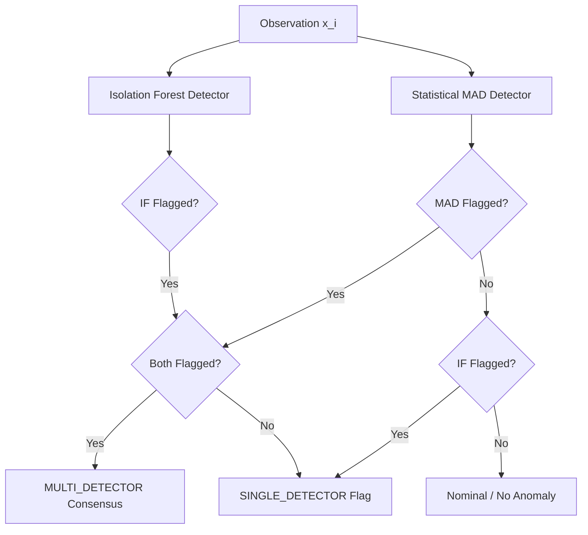

# KINTSUGI — System Architecture & Design Boundaries

## 1. System Overview

**KINTSUGI** (Confidence-Aware, Self-Healing Industrial Data Pipeline) is an industrial telemetry pipeline designed to ingest noisy, intermittent, or corrupted multi-sensor data, detect quality anomalies, reconstruct damaged signals using contextual machine learning and physics-informed models, assign evidence-based confidence scores to all proposed repairs, and preserve original un-altered sensor measurements in an immutable audit ledger.

The project takes its name from *Kintsugi* (金継ぎ), the traditional Japanese art of repairing broken pottery with lacquer dusted with powdered gold—treating flaws and repairs with full transparency and historical fidelity rather than concealing them.

---

## 2. Core Architectural Invariants

### 1. Preservation of Original Readings
Original measured sensor values (`rawMeasuredValue`) are permanently retained and NEVER overwritten, mutated, or deleted. All downstream consumers can inspect both the raw reading and the healed signal simultaneously. In Phase 4 and Phase 5, `preserve_original_readings` is enforced as an immutable invariant (`True`). Raw CSV datasets are mounted read-only and verified via SHA-256 integrity checks.

### 2. The Four Processing Statuses
Every telemetry data point evaluated by the pipeline is categorized into one of four mutually exclusive, strictly defined processing statuses:

| Status | Code | Meaning | Downstream Action |
| :--- | :--- | :--- | :--- |
| **MEASURED** | `01_RAW` | Original unmodified physical sensor reading. Verified within nominal operating boundaries. | Passed to downstream operational telemetry as trusted truth. |
| **ESTIMATED** | `02_PROP` | Candidate repaired value generated via contextual time-series or multivariate model imputation. | Internal intermediate proposal; pending confidence verification. |
| **CORRECTED** | `03_VERIF` | High-confidence validated repair. The candidate repair exceeds the required policy confidence threshold (e.g. $\ge 0.80$). | Approved for downstream control loops, labeled with repair metadata. |
| **UNRESOLVED** | `04_ABST` | Insufficient contextual evidence or corrupted neighboring channels. The system strictly **abstains from guessing**. | Flagged for operator review; safety interlocks alerted; no fabricated precision. |

### 3. Strict Requirement to Abstain
When evidence is ambiguous, sensor correlation is degraded, or uncertainty margins exceed permissible thresholds, the pipeline **MUST abstain**. Fabricating synthetic accuracy where none exists is prohibited.

---

## 3. Scope: Implemented vs. Planned Features

### Implemented Features (Phases 1 through 5)
* **Application Shell & Navigation**: Complete 8-route single-page application shell (`/overview`, `/datasets`, `/pipeline`, `/anomalies`, `/reconstruction`, `/audit`, `/evaluation`, `/settings`).
* **Zero-Dependency History Router**: Lightweight HTML5 History API client router supporting direct browser URL navigation, browser Back/Forward, automatic `/` to `/overview` redirect, and 404 Not Found handling.
* **Verified Backend Health Contract**: Live `GET /api/health` endpoint returning operational status, service identifier, API version, environment, and ISO-8601 UTC server timestamp with roundtrip latency tracking.
* **Dataset Ingestion Engine (Phase 3 Core Feature)**:
  * Multipart file upload (`POST /api/datasets/upload`) for CSV telemetry streams.
  * Multi-encoding support (`utf-8-sig`, `utf-8`, `latin-1`).
  * Strict validation against empty files, invalid extensions, header-only datasets, duplicate column names, empty column names, and mismatched row lengths.
  * Server-controlled isolated storage paths (`ds_{uuid}`) preventing path traversal.
  * Exact data quality audit calculations (row duplicates, missing counts, column types, descriptive statistics).
* **Pipeline Configuration Engine (Phase 4 Core Feature)**:
  * Typed, versioned configuration data model (`PipelineConfig`, `PipelineConfigCreate`, `PipelineConfigUpdate`).
  * Live validation endpoint (`POST /api/pipelines/validate`) validating against actual dataset schema, column types, and data quality without side-effects.
  * Persistence endpoint (`POST /api/pipelines`) saving atomic configuration files in `storage/pipelines/` with server-controlled IDs (`pipe_{uuid}`).
  * Configuration listing (`GET /api/pipelines`) and single retrieval (`GET /api/pipelines/{id}`).
  * Versioned update endpoint (`PUT /api/pipelines/{id}`) incrementing `configuration_version` and re-validating.
* **Real Sensor Anomaly Detection Engine (Phase 5 Core Feature)**:
  * Robust statistical anomaly detection via trailing rolling median and Median Absolute Deviation (MAD).
  * Multivariate Isolation Forest detection via `scikit-learn` with finite-sample filtering and exact source row mapping.
  * Explicit multi-detector aggregation policy distinguishing single-detector vs multi-detector consensus.
  * Documented severity classification rubric (`CRITICAL`, `HIGH`, `MEDIUM`, `LOW`).
  * Atomic detection run persistence in `storage/runs/{run_id}/run.json` and `anomalies.json`.
  * Dedicated API endpoints for execution (`POST /api/pipelines/{id}/run`), run status (`GET /api/pipelines/{id}/runs/{run_id}`), run results (`GET /api/pipelines/{id}/runs/{run_id}/results`), and anomalies catalog (`GET /api/anomalies`, `GET /api/anomalies/{anomaly_id}`).
  * Interactive Anomaly Explorer frontend with real pipeline selection, execution controls, KPI cards, SVG time-series visualization with anomaly overlays, filterable records table, and detailed observation modal.

### Planned for Future Phases
* **Signal Reconstruction & Imputation (Phase 6)**: Contextual multivariate regression, piecewise linear interpolation, and neighboring channel validation.
* **Confidence Scoring & Calibration (Phase 6)**: Empirical uncertainty margins and confidence evaluation.
* **Cryptographic Audit Ledger (Phase 7)**: SHA-256 hash chains documenting all repair proposals and operator decisions.
* **Evaluation Center Benchmarking (Phase 8)**: Precision, recall, F1, RMSE, MAE, and abstention rate metrics against ground-truth datasets.

---

## 4. Real Sensor Anomaly Detection Architecture (Phase 5)

### 1. Robust Statistical Detector (Trailing Rolling Median & MAD)
* **Mathematical Definition**:
  For an indexed series $x_0, x_1, \dots, x_{N-1}$ and trailing window size $w$:
  $$W_i = \{x_k \mid \max(0, i - w + 1) \le k \le i \text{ and } x_k \in \mathbb{R}_{\text{finite}}\}$$
  $$\tilde{x}_i = \text{median}(W_i)$$
  $$\text{MAD}_i = \text{median}(\{|x_k - \tilde{x}_i| \mid x_k \in W_i\})$$
  $$\text{Score}_i = \frac{|x_i - \tilde{x}_i|}{\text{MAD}_i}$$
* **Threshold Condition**:
  Observation $x_i$ is flagged if $\text{Score}_i > T_{\text{MAD}}$ (`mad_threshold`).
* **Trailing Window Self-Participation**:
  The current observation participates in its own trailing baseline window $W_i$. Because median and MAD have a 50% breakdown point, an isolated transient impulse cannot corrupt or bias the baseline.
* **Zero-MAD & Constant Signal Handling**:
  In industrial plants, sensors often rest at constant operating values (e.g. constant $50.0^\circ\text{C}$). If more than 50% of the observations in $W_i$ are identical, $\text{MAD}_i = 0.0$:
  * **Nominal Match**: If $|x_i - \tilde{x}_i| \le 10^{-9}$, the reading matches the constant window median. It is marked **nominal** (`flagged=False`, `score=0.0`) to prevent false-positive cascades.
  * **Step / Impulse Deviation**: If $|x_i - \tilde{x}_i| > 10^{-9}$, the reading deviates from a flat baseline. It is safely flagged with sentinel `score=999.0` avoiding division by zero.
* **Edge Windows & Minimum Observations**:
  If $|W_i| < \text{min\_observations}$, the detector declines to evaluate $x_i$ and records `flagged=False` with reason "Insufficient valid historical observations in trailing window".
* **Missing & Non-Finite Data**:
  Missing (NaN) and non-finite ($\pm\infty$) samples are never silently replaced. They are documented with reason "Observation is missing or non-finite (NaN/Inf); statistical outlier detection requires finite scalar".

---

### 2. Multivariate Isolation Forest Detector
* **Algorithm**:
  Fits an ensemble of isolation trees on numeric sensor channels using `sklearn.ensemble.IsolationForest`.
* **Reproducibility**:
  Explicitly sets `random_state=random_seed` ensuring deterministic partitions across identical inputs.
* **Finite Row Filtering & Row Mapping**:
  Isolation Forest requires 2D finite matrices. Rows containing any NaN or Inf across configured sensor channels are filtered out for model fitting, while retaining a strict array index mapping back to original CSV rows (`source_row_index`).
* **Minimum Observation Enforcement**:
  If the count of usable finite rows is less than `min_observations`, the detector safely declines to fit and returns an advisory warning.
* **Zero Variance Safeguard**:
  If all features exhibit zero variance (completely constant signals), Isolation Forest is bypassed with an advisory warning.

---

### 3. Detector Consensus & Severity Rubric

Each detector records its independent results in `detector_details`. KINTSUGI applies an explicit aggregation policy:



* **Consensus Types**:
  * `MULTI_DETECTOR`: Both detectors independently flagged the point.
  * `SINGLE_DETECTOR`: Exactly one detector flagged the point.
  * `NORMAL`: Neither detector flagged the point (not stored in anomalies catalog).
* **Documented Severity Rubric**:
  * `CRITICAL`: Multi-detector consensus with extreme deviation ($>2.0\times$ MAD threshold or IF score $< -0.15$).
  * `HIGH`: Any multi-detector consensus, or single-detector flag with extreme deviation.
  * `MEDIUM`: Single-detector flag exceeding threshold margin.
  * `LOW`: Borderline single-detector flag near threshold boundary.
* **Anomaly vs. Confirmed Fault Disclaimer**:
  Detector agreement demonstrates corroborating mathematical suspicion across localized dispersion and decision tree splits; **it does NOT constitute physical proof of a hardware fault**.

---

### 4. Persistence Architecture

```
backend/storage/
├── datasets/
│   └── ds_{uuid}/
│       ├── data.csv                 # Raw sensor CSV (IMMUTABLE, READ-ONLY)
│       ├── metadata.json            # Dataset catalog metadata
│       └── quality.json             # Data quality audit
├── pipelines/
│   └── pipe_{uuid}.json             # Saved pipeline configuration (v1, v2...)
└── runs/
    └── run_{uuid}/
        ├── run.json                 # Run execution state, summary counts, warnings
        └── anomalies.json           # Array of individual AnomalyRecord objects
```

* **Data Preservation**: Raw CSV files in `storage/datasets/` are strictly read-only and never modified by detection runs.
* **Atomic Writes**: All JSON persistence uses `.tmp` files committed via atomic `os.replace`.

---

## 5. API Contracts Summary

### Pipeline Execution & Results
* `POST /api/pipelines/{pipeline_id}/run`
  * Executes detection using saved configuration.
  * Returns `DetectionRunResponse` (`run` metadata and `sample_anomalies`).
* `GET /api/pipelines/{pipeline_id}/runs/{run_id}`
  * Retrieves run status (`completed`, `failed`, `partial_failure`), duration, and `summary` metrics.
* `GET /api/pipelines/{pipeline_id}/runs/{run_id}/results?limit=50&offset=0`
  * Retrieves paginated anomaly records for the specified run.

### Anomalies Catalog
* `GET /api/anomalies?dataset_id={id}&run_id={id}&sensor_column={col}&detector_name={name}&severity={sev}&limit=50&offset=0`
  * Queries and filters anomaly records across persisted runs.
* `GET /api/anomalies/{anomaly_id}`
  * Retrieves detailed per-detector diagnostics for a specific anomaly record.
